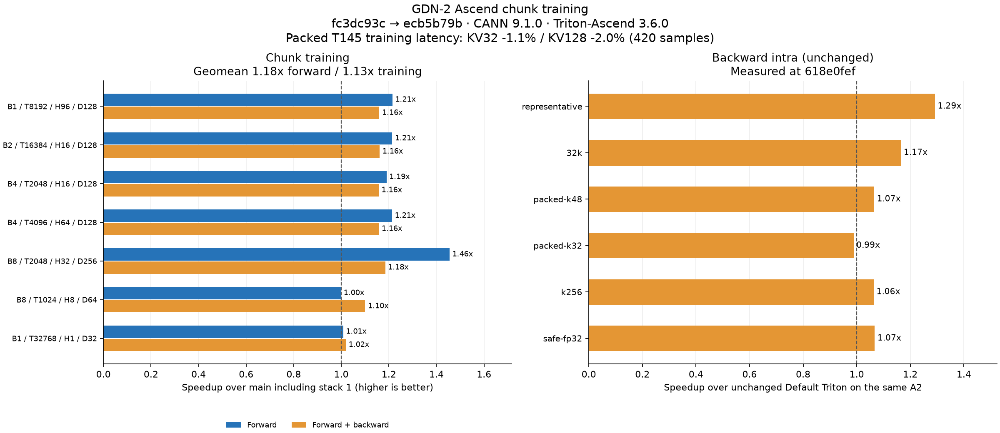

# GDN2 Ascend chunk training A2 measurements

`fc3dc93c` → `ecb5b79b`; previous PR head `618e0fef`.

Seven BF16 shapes: forward 1.1764× / training 1.1331× geometric mean. Packed T145 training latency changes: KV32 -1.088% / KV128 -2.044%.

[Samples, statistics, validation and profiles](gdn2-stack2-measurements.json)

[Timing harness](gdn2-a2-bench.py): select each checkout with PYTHONPATH; `taskset -c 0-7 python gdn2-a2-bench.py --out result.json --warmups 3 --samples 10`. Use upstream → previous PR → candidate → candidate → previous PR → upstream order on physical NPU4. Packed confirmation: --case-prefix packed_ --warmups 20 --samples 200, two rounds per version.

Runtime hashes match the published commit; the final validation snapshot additionally includes the wider-V tests. Unchanged intra-backward/cold/profile measurements are explicitly retained from 618e0fef. H100 remains unrun. The baseline common-state VK/K256 BF16 UB limitation is recorded separately.
